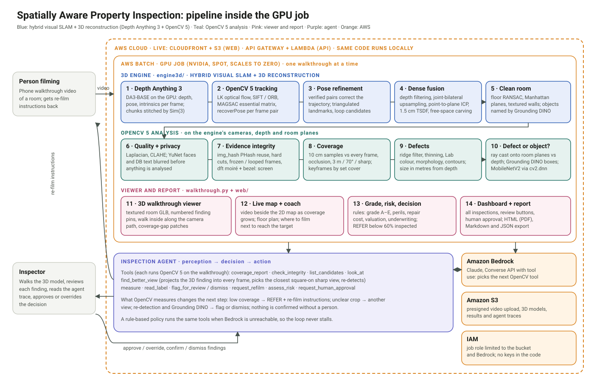
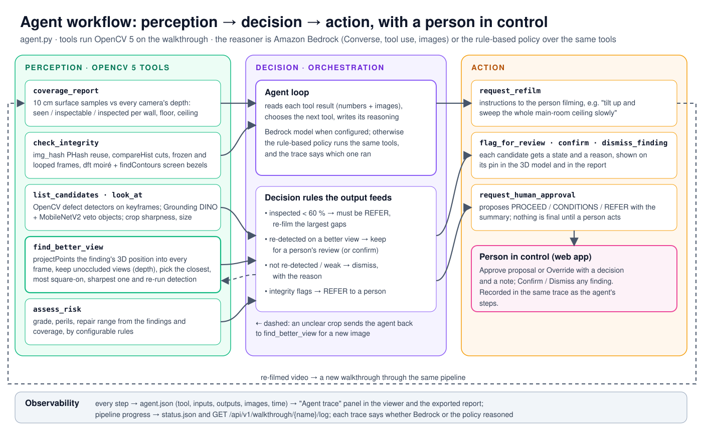

# Spatially Aware Property Inspection

Technical report · Team XCore · OpenCV AI Competition 2026 (powered by AWS) · Agentic Vision path

## 1. Problem

Insurers, lenders and landlords need to know the condition of a property, and more of that evidence now arrives as a
phone video filmed by an owner, tenant or field agent rather than as an inspector's visit. Two things go wrong:

1. **Coverage.** People film what they notice. In our earlier tests with phone walkthroughs, only 20–43% of the room
   surface was filmed well enough to inspect, and ceilings (where leaks show first) were almost never filmed.
   Nobody finds out until the video is reviewed, when the person has left.
2. **Evidence.** A defect in a video frame has no position, no size and no context: it cannot be found again,
   measured, or compared with the next inspection.

## 2. Users

- **Insurers and lenders** deciding whether a property is acceptable, needs repair, or needs more evidence.
- **Field agents, tenants and owners** filming the property, who need clear instructions on what is still missing.
- **Inspectors** who review the evidence and make the final call.

## 3. What the system does

From one phone video of a room:

1. **Hybrid visual SLAM and 3D reconstruction** (`engine3d/`, on the GPU). Depth Anything 3 predicts depth, camera
   pose and intrinsics for every sampled frame. OpenCV 5 then checks and corrects that geometry: LK optical-flow
   tracks, SIFT + MAGSAC essential-matrix verification of every frame pair, trajectory refinement, persistent
   landmarks with reprojection checks and ORB loop candidates. Each frame's depth is aligned to the growing model by
   point-to-plane ICP, fused into a 1.5 cm TSDF mesh with free-space carving, and put in a gravity + Manhattan frame.
   The clean room geometry (walls, doors, openings, floor, ceiling, rooms) is fitted on that mesh and textured from
   the video; furniture is separated from the structure and named by multi-view voting of Grounding DINO boxes.
2. **Coverage.** Every 10 cm of wall, floor and ceiling is checked against every frame's depth (occlusion-aware):
   seen, inspectable (within 3 m, at most 70° off straight-on, sharp) and inspected (in an analysed keyframe), with
   the largest gaps listed and a coverage coach that shows where to film next.
3. **Defects.** OpenCV finds candidates (cracks, stains and water damage, mould, rust, peeling paint) on the
   keyframes, places each one in 3D on a named surface and measures it in metres. Candidates that are furniture,
   doors, pictures or rooms seen through an opening are ruled out by depth against the room planes, by Grounding
   DINO boxes and by MobileNetV2; Grounding DINO damage boxes corroborate the rest.
4. **Evidence integrity.** Perceptual hashes against earlier walkthroughs, hard cuts, frozen or looped footage and a
   screen being filmed.
5. **Agent.** An agent on Amazon Bedrock works through the evidence with OpenCV tools: it fetches better views from
   other frames, re-detects, flags or dismisses, asks for parts of the room to be filmed again, grades the risk and
   proposes a decision (ACCEPT, REFER or REPAIR) that a person approves or overrides. Every finding can be confirmed,
   dismissed or reopened by the inspector, and the grade follows.
6. **Photoreal room.** 3D Gaussian splats start on the engine's surface and are trained (gsplat) against the video
   frames from the engine's cameras, so the room can be seen from any angle looking like the video, not like a mesh.
7. **Viewer.** A 3D model of the room with numbered finding pins, a walk-inside mode that puts the browser camera
   where the phone was at each moment of the video, a live map video of coverage growing as the person walked, the
   floor plan, the agent's trace and a report.

## 4. OpenCV 5 implementation

| Stage | OpenCV 5 functionality | Module |
| --- | --- | --- |
| Frames | `VideoCapture` sampling, `resize` (`INTER_AREA`), `cvtColor` | `engine3d/v1prod/da3_infer.py` |
| Camera tracking | `goodFeaturesToTrack`, `calcOpticalFlowPyrLK`, `undistortPoints`, `SIFT_create`, `ORB_create`, `BFMatcher`, `findEssentialMat` (USAC MAGSAC), `findHomography`, `recoverPose` | `engine3d/v1prod/slam/tracking.py`, `verify.py`, `loops.py` |
| Pose refinement | per-pair relative-pose agreement, outlier jumps replaced, trajectory refined against the verified pairs | `engine3d/v1prod/slam/refine.py` |
| Landmarks | `triangulatePoints`, `Rodrigues`, `projectPoints` reprojection RMSE per frame | `engine3d/v1prod/slam/landmarks.py` |
| Depth filtering | flying pixels (`dilate` / `erode` depth jumps, `Canny`), `bilateralFilter`, `ximgproc.jointBilateralFilter` upsampling to full resolution, `connectedComponentsWithStats`, grazing-angle cut | `engine3d/v1prod/slam/depth_filter.py`, `room.py` |
| Real-world texturing | walls / floor / ceiling textured from the video with per-frame exposure gains and a vignetting model; `inpaint` for small unseen holes, `dft` / `mulSpectrums` / `idft` pattern synthesis for unseen floor | `engine3d/v1prod/shell.py`, `render.py` |
| Floor plan and maps | occupancy grid, `morphologyEx`, `distanceTransform`, `findContours`, `approxPolyDP`, `minAreaRect`, `fillPoly`; A* path on the navigation grid | `engine3d/v1prod/maps2d.py`, `slam/occupancy.py` |
| Video and quality | `Laplacian` variance, `calcHist`, `createCLAHE` | `pipeline.py` |
| Privacy | `FaceDetectorYN` (YuNet), `dnn.TextDetectionModel_DB` (PP-OCRv3), `GaussianBlur` | `privacy.py` |
| 3D fusion | `Volume` (hash TSDF), `VolumeSettings`, `fetchPointsNormals`, `savePointCloud` | `fusion.py` |
| Coverage | surface samples projected into every frame, depth-buffer occlusion, 3 m / 70° / sharp rule | `coverage.py`, `spatial/coverage.py` |
| Evidence integrity | `img_hash.PHash`, `compareHist`, `dft` + `createHanningWindow` (moiré), `findContours` + `approxPolyDP` (bezels) | `integrity.py` |
| Defect evidence | `ximgproc.RidgeDetectionFilter`, `ximgproc.thinning`, `distanceTransform`, morphology, Lab colour statistics, `SimpleBlobDetector`, `HoughLinesP`, `connectedComponentsWithStats`, `findContours` | `defects.py` |
| Defect or object | ray cast onto the room planes vs depth; `dnn.readNet` MobileNetV2 (ImageNet) on the crop | `localize.py`, `objects.py` |
| Review crops | `createCLAHE`, `fastNlMeansDenoisingColored` | `enhance.py` |
| Wall rectification | plane-induced homographies, `warpPerspective`, depth-based occlusion masks, weighted blending | `ortho.py` |
| Labels | `dnn.TextDetectionModel_DB` + `dnn.TextRecognitionModel` (CRNN), `getPerspectiveTransform` | `ocr.py` |
| Viewer media | live map frames drawn with OpenCV (`polylines`, `fillPoly`, `putText`), annotated keyframes | `spatial/map2d.py`, `walkthrough.py` |

Learned models complement OpenCV where geometry alone is not enough: Depth Anything 3 (depth and an initial pose),
Grounding DINO (object names; "is this on a chair or the wall?"), MobileNetV2 through `cv2.dnn`. Every process caps
OpenCV at a fixed number of threads (`setNumThreads`) and runs at reduced priority on a workstation.

Without an NVIDIA GPU, an OpenCV-only path still runs (`pipeline.py`): LK + MAGSAC visual odometry with
`solvePnPRansac`, Depth Anything V2 Small through `cv2.dnn` on the CPU, and the same analysis.

## 5. Agentic Vision: perception → decision → action

The agent (`agent.py`) is a tool-using model on Amazon Bedrock (Converse API, images in tool results). Its tools run
OpenCV 5 on the walkthrough, and their results decide what it does next:

- **Coverage → action.** If less than 60% of the surface was inspected, the decision must be REFER, and the agent
  writes re-film instructions for the largest gaps ("tilt up and sweep the whole main-room ceiling slowly").
- **Unclear evidence → new perception.** If a crop is blurred, far or ambiguous, `find_better_view` projects the
  finding's 3D position into every other frame, keeps the frames where the depth map shows it unoccluded, picks the
  closest, most square-on, sharpest view, re-runs OpenCV detection on it and shows the agent the new image.
- **Re-detection → decision.** The candidate is confirmed (with a severity) or dismissed (with a reason).
- **Human control.** The run ends with `request_human_approval`; the inspector approves or overrides in the web
  app, and that is recorded in the same trace.

Every step is written to `agent.json`: the model's reasoning, each tool call with its inputs and outputs, and the
images it looked at. When Bedrock is not reachable the same tools run under a rule-based policy, and the trace says so.

### 5.1 Trace: OpenCV 5 output changes the next action

From `results/demo_property_lite/agent.json` (29 steps, rule-based policy; the same trace is the **Agent trace** panel
in the viewer). Each row is a tool call whose OpenCV 5 output decided what the agent did next:

| Step | Tool (perception) | OpenCV 5 output | What it changed (decision → action) |
| --- | --- | --- | --- |
| 1 | `coverage_report` | 38.6% of the surface inspected (minimum 60%); ceiling 0.3% | steps 2-4: `request_refilm` for the main-room ceiling, the main-room floor and the south wall; the decision must be REFER |
| 5 | `check_integrity` | 187 frames hashed, no reuse, cuts, loops or screen moiré | integrity low, so no fraud referral |
| 7-9 | `look_at` → `find_better_view` F001 | crop score 0.59; best other view frame 67 at 2.36 m, 17.6°: rust re-detected at **0.995** | `flag_for_review` F001 ("possible rust: seen again in frame 67") |
| 16-18 | `look_at` → `find_better_view` F007 | crop score 0.50; best other view frame 162 at 3.25 m: **nothing re-detected**, sharpness 22.9 | `dismiss_finding` F007 ("weak evidence") |
| 28-29 | `assess_risk` → `request_human_approval` | 3 findings for review, 39% inspected, grade A (96.7), repairs USD 280-1,900 | proposes REFER and waits for a person |

On tom_home the same loop ran in 8 steps: 17.2% inspected led to three re-film requests (ceiling, floor, east wall)
and REFER; no candidate survived the 3D and object checks, so no finding was proposed.

### 5.2 Agent evaluation

| Criterion | Evidence |
| --- | --- |
| Task success | Every walkthrough ends with a proposal and its reasons: demo home and tom_home locally, the synthetic room on AWS. All three are below 60% inspected and all three are REFER, as the rule requires; the re-film requests name the largest measured gaps (the ceiling first in both homes). On the demo home 7 candidates were re-checked from another view: 3 re-detected and kept for review, 4 not re-detected and dismissed with the reason. |
| Failure handling | No Bedrock model or no network: the rule-based policy runs the same tools and the trace records `engine: policy` (the live deployment runs this way). No candidates: the agent still runs coverage, integrity and risk (tom_home). A failed GPU job is marked failed with its log and can be re-run from the app without re-uploading (the first AWS smoke runs failed in the 3D engine and show as failed with their log; later runs completed). Integrity flags force a referral to a person. |
| Observability | `agent.json` keeps every step (tool, inputs, outputs, images, time) and is shown as the Agent trace in the viewer and in the report; pipeline progress is in `status.json` and `GET /api/v1/walkthrough/{name}/log`; the 3D engine writes `engine.log` and `08_evaluation/evaluation.json`. |
| Human control | The agent can only propose: `request_human_approval` leaves the walkthrough "awaiting approval" until a person approves or overrides it with a note, and any finding can be confirmed or dismissed by a person. Both are written into the same trace. |

## 6. AWS deployment

The app is live at <https://d3ppa06ysdffln.cloudfront.net> (no login), deployed serverless so that it costs nothing
while idle and pays per walkthrough. It follows the team's AWS deployment plan; the live stack runs in us-east-2.

| Piece | AWS resource | Notes |
| --- | --- | --- |
| Edge | Amazon CloudFront + Origin Access Control | A CloudFront Function routes `/` to the console, `/walkthroughs/<name>/` to the viewer and that walkthrough's results, and `/api/*`, `/docs` to API Gateway (no caching). JSON is served `no-store`. |
| Storage | One private S3 bucket | `web/` (console, viewer), `uploads/<name>/` (the video, presigned PUT, 1 h), `results/<name>/` (status, walkthrough JSON, GLBs, splat, videos, findings, `agent.json`, reports; about 95 files per run), `deploy/` (source zip). Public access blocked; CORS for the browser PUT. |
| API | API Gateway (HTTP API) + AWS Lambda | FastAPI via Mangum in a container image (1.5 GB, 60 s): upload-url, start, log, status, list, portfolio, ask, approve, findings review, report. Uploads bypass it (10 MB gateway limit). |
| GPU work | AWS Batch: job queue, managed EC2 compute environments (Spot, price-capacity optimised, plus on-demand fallback) | 0 to 1 instance (g4dn.xlarge T4, g5.xlarge A10G, g6.xlarge L4), ECS GPU AMI, 120 GB gp3. Job: 1 GPU, 4 vCPU, 14.5 GB, 4 h timeout. It runs the unchanged pipeline (3D engine, splats, OpenCV 5 analysis, agent, viewer build), streams `status.json` and logs to S3 every 5 s and uploads the results; the instance then terminates. |
| Images | Amazon ECR + AWS CodeBuild | GPU image (CUDA 12.4, Python 3.11, PyTorch 2.5.1, gsplat, model weights baked in, about 15 GB) and API image, built by CodeBuild from a source zip in the bucket. |
| Agent | Amazon Bedrock (Converse) | Called from the job when a model is configured; the live stack has none, so the rule-based policy runs. |
| Access | AWS IAM, SSM Parameter Store | Five roles, each limited to the bucket and its one service; no access keys in AWS; IMDSv2; no inbound rules on the Batch security group. An API key in Parameter Store protects the API; it is switched off for judging. |
| Logs | Amazon CloudWatch Logs | `/aws/lambda/spatial-inspection-api`, `/aws/batch/spatial-inspection`, CodeBuild logs. |
| Infrastructure | AWS CloudFormation | A build stack (bucket, ECR, CodeBuild) and an app stack (Batch, Lambda, API Gateway, CloudFront, IAM), created by one deploy script that also syncs `web/` and invalidates CloudFront; a destroy script removes both. |

Measured on the live deployment for a 16 s synthetic-room video in Lite mode: the upload reached S3 in 6 s, the job
waited 6 min 25 s for AWS Batch to start a GPU instance (cold start, NVIDIA A10G), the pipeline took 13 min 46 s, and
the 95 result files reached S3 in 1 s, about 20 minutes end to end. `GET /api/v1/health` reports OpenCV 5.0.0, the
GPU backend, S3 and the queue. Earlier runs on an NVIDIA T4 failed in the 3D engine; they show as failed in the app
with their log and a re-run button. When idle only S3 and CloudFront cost anything (a few USD a month); a
walkthrough costs the Spot GPU minutes plus requests and transfer.

`deploy/aws/` in this repository keeps the earlier single-instance deployment: `deploy.sh` creates a bucket, a role
limited to that bucket and Bedrock, a security group and an EC2 instance, and `bootstrap.sh` installs the pinned
dependencies, downloads the models with SHA-256 checks and starts the service.

## 7. Evaluation

### 7.1 Setup

Two phone walkthroughs of furnished homes in Sri Lanka, filmed handheld at 848×480, 30 fps:
`demo_property_lite` (19.6 s, two rooms) and `tom_home` (21.1 s, one open-plan living room with a staircase).
The engine samples 10 frames per second: 197 and 212 frames. Everything ran on one laptop (NVIDIA RTX 3080 Laptop
GPU, 16 GB) with every thread pool capped at 2 threads, below-normal priority and one job at a time.

There is no LiDAR scan or tape survey of these rooms and neither room has visible damage, so this section reports
(a) the engine's own consistency checks, (b) agreement with the Property Inspection Platform's engine and with our
CPU-only OpenCV path, (c) what happened to every defect candidate, checked by hand, (d) the integrity checks on honest
and doctored footage, and (e) runtime. Defect recall cannot be measured on these videos (section 8).

### 7.2 Hybrid SLAM and reconstruction

| Measure | demo_property_lite | tom_home |
| --- | --- | --- |
| Frames used / keyframes | 197 / 73 | 212 / 77 |
| Depth Anything 3 | reused from an earlier run of the same video | 3 chunks of 100 frames, 19.7 s on the GPU |
| OpenCV pair checks (pass / warn / fail / too few features) | 115 / 20 / 5 / 56 | 144 / 1 / 5 / 61 |
| DA3 pose vs OpenCV essential matrix, rotation (mean), raw → refined | 0.93° → 0.86° | 0.44° → 0.44° |
| … translation direction (median), raw → refined | 35.5° → 32.4° | 51.4° → 44.0° |
| Trajectory jitter (mean acceleration), raw → refined | 0.061 → 0.033 m | 0.028 → 0.014 m |
| Verified landmarks; reprojection median / RMSE | 1,404; 2.32 / 3.47 px | 2,786; 1.86 / 3.17 px |
| ICP: median depth disagreement, pass 1 → pass 2 | 4.5 → 2.5 cm (184 of 197 frames accepted) | 3.9 → 2.7 cm (209 of 212) |
| Walls: RMS of the measured surface about the fitted plane (median over walls) | 3.9 cm (5 walls) | 3.1 cm (14 walls) |
| Textured clean model rendered from each video camera vs the frame: PSNR / SSIM (exposure-matched) | 18.1 dB / 0.80 | 20.5 dB / 0.84 |
| Clean model vs measured mesh: share within 5 cm (completeness / accuracy) | 67% / 69% | 82% / 74% |
| **Gaussian splats on held-out frames** (1 in 10, never trained on): PSNR / SSIM | **24.7 dB / 0.86** | **28.4 dB / 0.93** |
| Splats: training time on the GPU, count, file | 2.5 min, 0.71 M, 21.7 MB | 2.4 min, 0.83 M, 25.5 MB |
| Room model | main room 25.8 m² (4.7 × 6.05 m) + 1.6 m²; ceiling 2.67 m; 6 walls, 4 doors | 45.8 m² (8.2 × 8.4 m); ceiling 3.11 m; 14 walls, 4 doors, 4 openings |
| Objects named by Grounding DINO | 10 of 15 (sofas, armchairs, mirror, TV, lamp, doors) | 15 of 31 (sofa, armchairs, table, staircase, shelf, mirror, fan, stool, picture frame, bucket, doors) |

The splats are the realistic view of the room: on frames they never saw they score 6.6 dB (demo) and 7.9 dB
(tom_home) above the textured mesh rendered from every frame, and their renders are hard to tell from the video
except for thin, moving or reflective things (a fan, glossy floor). They depend on the engine: the Gaussians start on
its TSDF surface and are optimised only for appearance from its fixed, OpenCV-refined camera poses.

OpenCV's checks matter most where Depth Anything 3 is least sure: the refinement halves the trajectory jitter on
both videos and moves the poses towards the epipolar geometry OpenCV measures; ICP then halves the depth
disagreement between frames before fusion. Rotation agrees with OpenCV to under 1°. The translation direction
between neighbouring frames agrees less well (32–44° median) because their baselines are a few centimetres, where
the direction is poorly constrained for both methods.

### 7.3 Agreement with other measurements

- **Platform engine.** The same engine code reproduces the platform's model of `tom_home`: 8.2 × 8.4 m and a 3.11 m
  ceiling. On `demo_property_lite` the platform's earlier run (3 cm lite build, its own keyframes) measured 66.9% seen,
  50.6% inspectable and 42.5% inspected; this run measures 61.6%, 48.9% and 39.6%.
- **OpenCV-only path (CPU, no GPU).** On `demo_property_lite` against the engine's trajectory: absolute trajectory
  error 0.183 m RMSE (median 0.153 m) over a 12.7 m path after a Sim(3) fit (scale 0.953), median rotation error
  2.55°; Depth Anything V2 Small through `cv2.dnn` has AbsRel 0.129 (median error 0.20 m) against the engine's depth;
  0.51 s per frame. Coverage computed by our OpenCV code on the engine's cameras matched the platform's (50.2% /
  42.3% vs 50.6% / 42.5%). On `tom_home` the CPU path put the ceiling at 3.66 m against the engine's 3.11 m, one
  reason the GPU engine is the default.

### 7.4 Coverage and the agent's decision

| Seen / inspectable / inspected (%) | demo_property_lite | tom_home |
| --- | --- | --- |
| Walls | 71.6 / 60.9 / 50.1 | 74.7 / 38.0 / 24.3 |
| Floor | 79.8 / 74.6 / 62.5 | 80.5 / 59.4 / 35.2 |
| Ceiling | 27.0 / 4.5 / 0.6 | 54.1 / 0.0 / 0.0 |
| **Overall** | **61.6 / 48.9 / 39.6** | **70.5 / 32.1 / 20.1** |
| Largest gap | main-room ceiling, 25.6 m² | main-room ceiling, 48.1 m² |

Both walkthroughs are below the 60% inspected minimum, so the agent proposes REFER in both and sends three re-film
requests each, led by the ceiling, which neither person filmed from close enough. The rule-based policy ran these
(14 and 8 steps); every proposal waits for a person's approval in the viewer.

### 7.5 Defect candidates

| Outcome of every OpenCV candidate (score ≥ 0.35) on the keyframes | demo_property_lite | tom_home |
| --- | --- | --- |
| Candidates | 67 | 83 |
| Ruled out: furniture or an object in front of the wall (depth vs room planes, Grounding DINO, MobileNetV2) | 40 | 47 |
| Ruled out: on a door or window | 25 | 22 |
| Ruled out: seen through an opening / outside the room model | 0 / 0 | 12 / 2 |
| Dismissed by the agent after a second view | 1 | 0 |
| Left for a person to review | 1 | 0 |
| Confirmed | 0 | 0 |

Both rooms are in good condition, so every candidate is a false positive and the system should confirm nothing,
which it does. What matters is how many reach a person. On `demo_property_lite`, classical detectors alone flagged
60 candidates (chairs, a wooden door, a clock, picture frames); placing each one against the room planes and depth
and adding MobileNetV2 cut that to 12; the hybrid engine's room model plus Grounding DINO cut it to 1. Grounding
DINO alone ruled out 11 and 8 candidates that the depth check let through because they are on or right against the
wall: chairs and a sofa pushed to the wall, clocks, a picture frame, a curtain, a light switch, a shelf. The one left is a failure case: the dark edge of a wooden door cut off by the left border
of the frame, labelled "rust" (section 8).

### 7.6 Evidence integrity

Both honest walkthroughs: integrity low, no flags (moiré median 1.64 and 1.41 against a threshold of 3.0; no hard
cuts, loops or reused footage; frozen footage 0.0 s and 0.1 s). On doctored copies made for testing, all four
manipulations were flagged: the same footage submitted for another property, a spliced cut, a looped segment, and
the video filmed off a laptop screen (moiré median 3.6).

### 7.7 Runtime

| Stage (RTX 3080 Laptop, 2 threads per pool) | demo_property_lite | tom_home |
| --- | --- | --- |
| 3D engine | 15.4 min (Depth Anything 3 reused) | 16.3 min |
| OpenCV analysis | 61 s (privacy 21 s, defects with Grounding DINO 29 s, `cv2.Volume` fusion 7 s) | 80 s (32 s, 31 s, 11 s) |
| Gaussian splats (7,000 steps, GPU) | 2.5 min | 2.4 min |
| Viewer files (coverage, live map video, GLBs with pins) | 76 s | 116 s |

The engine's CPU steps (ICP alignment, the 1.5 cm TSDF, texturing) take most of the time; the thread caps keep a
laptop usable at the cost of speed. The `--mode lite` build (3 cm TSDF, one alignment pass, no preview videos) is the
faster option.

## 8. Limitations

- **No ground truth here.** Neither room has a LiDAR scan, a tape survey or real damage. The reconstruction numbers
  are consistency and agreement measures, and defect recall is not measured: footage of rooms with real cracks, damp
  and mould is the next evaluation.
- **Scale comes from an assumed camera height** (1.5 m above the fitted floor; scale factors ×2.78 and ×4.20 here).
  A phone held higher or lower scales every distance, area and the 3 m "inspectable" rule with it.
- **Ceilings are the blind spot of phone walkthroughs**: 0.6% and 0% inspected. The system reports this and refers
  rather than assuming the ceiling is fine, but it cannot find a leak nobody filmed.
- **Failure case: objects cut by the frame edge.** The one candidate left on `demo_property_lite` is a sliver of a
  dark door at the image border. Grounding DINO needs to see most of an object to box it, and the door in the room
  model did not reach that part of the frame. The agent sent it to a person instead of confirming it.
- **Failure case: classical detectors confuse objects with damage.** Without the room model and Grounding DINO, 60
  candidates on a room with no damage were mostly brown chairs and wooden doors. The semantic veto is required. Grounding DINO
  tiny's damage boxes corroborated none of the candidates that reached review, so they add little on fine cracks.
- **Failure case: the CPU-only path drifts in scale** (ceiling 3.66 m against 3.11 m on `tom_home`). Without an
  NVIDIA GPU the measurements are less reliable.
- **Manhattan rooms.** Walls are fitted as planes on two perpendicular axes; curved or angled walls stay in the
  measured mesh and are not inspected as walls.
- **No global loop closure.** One and zero loops were verified; drift over a long multi-room walk is not corrected.
- **Model, not evidence, where unseen.** Surfaces the video never saw are filled in the textured model (synthesised
  floor pattern, median wall colour) and marked as inferred; furniture backs and undersides are missing; 21 of 46
  objects stay unnamed.
- **Integrity checks** were tested on synthetic manipulations and calibrated on two honest videos.
- **Splats are appearance, not measurement.** Findings, sizes and coverage come from the engine's mesh and depth;
  the splats are for looking. They are blurred where the video was blurred or never looked, float a little near the
  first and last cameras, and need their own environment (gsplat's Windows wheels exist for Python 3.10 only).
- **Not in these runs:** the Bedrock agent (the rule-based policy ran the same tools; AWS deployment is pending).

## 9. Responsible use

- Faces and private text are blurred before any analysis, before anything is stored, and before any image reaches
  the model.
- The agent proposes; a person decides. Every decision is recorded with the evidence behind it, and overrides are
  kept.
- Coverage is reported honestly: surfaces that could not be filmed (behind furniture) and surfaces that were not
  filmed are listed as not inspected, never assumed fine.
- Models: Depth Anything 3 BASE (Apache-2.0), Grounding DINO tiny (Apache-2.0), OpenCV Zoo YuNet (MIT), PP-OCRv3,
  CRNN and MobileNetV2 (Apache-2.0), Depth Anything V2 Small (Apache-2.0); no non-commercial weights.
